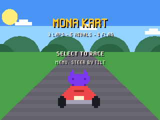
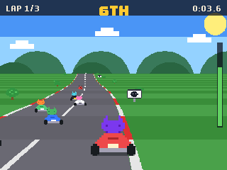
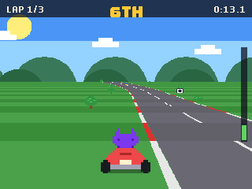
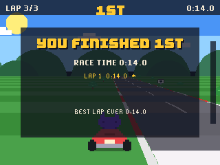

# Mona Kart for the GitHub Universe 2026 badge

A pseudo-3D kart racer for the GitHub Universe 2026 badge. Mona races five
rival Octocats over three laps: tilt to steer, grab coffee for a boost, dodge
the bugs, and the badge remembers your best lap.

| Title | Race | Curve | Finish |
| --- | --- | --- | --- |
|  |  |  |  |

## Install

1. Put the badge in USB Disk Mode (open the Mass Storage app, or double-tap
   RESET) so the `BADGER` volume appears.
2. Copy the `apps/mona_kart` folder into `BADGER/apps/` (so you end up with
   `BADGER/apps/mona_kart/__init__.py`).
3. If your badge still runs the stock event menu, its tiles ignore `icon.png`.
   The [hyb26 skill](https://github.com/badger/home/tree/main/.github/skills/hyb26-skill)
   ships `patch_menu_icons.py`, which adds that support (with a backup).
4. Eject the volume. The badge restarts into the menu with a Mona Kart tile.

No network or extra hardware is needed.

## Controls

| Button | Action |
| --- | --- |
| Tilt, or Left / Right | Steer |
| Select | Start the race; race again from the results |
| Back | Brake; back to the title from the results |
| Menu | Switch between tilt and button steering (title screen) |

The kart accelerates by itself. Running onto the grass slows you down, bumping
a rival costs speed, a coffee gives a boost and a bug makes you wobble. Best
lap, best race and wins are saved under `/state`.

## How it works

- `apps/mona_kart/__init__.py` holds the whole game: an OutRun-style road made
  of curved, hilly segments projected from a camera behind the kart, sprites
  scaled by depth and clipped behind hills, five rubber-banded rivals, and the
  title, countdown, race and results screens.
- The per-row road spans run in a `@micropython.viper` function with
  fixed-point maths: the plain Python loop cost 50ms a frame on the badge, the
  viper version about 20ms, which keeps the race near 25 frames a second.
- The nearest road segments are walked in quarter steps so their edges bend
  with the perspective instead of kinking.
- `apps/mona_kart/assets/karts.png` and `props.png` are drawn from pixel maps
  by `tools/build_sprites.py`: six Mona kart colours with three steering
  frames each, plus trees, bushes, an Octocat sign, coffee and a bug.

## Tools

- `tools/build_sprites.py` regenerates the sprite sheets.
- `tools/badge_harness.py` drives the game's frame loop on a real badge over
  `mpremote run`, simulating steering and saving run-length encoded
  screenshots to `/state/shots`; `tools/rle2png.py` converts them.

Mona is GitHub's Octocat mascot; this is a fan project and not affiliated
with GitHub or Nintendo.
